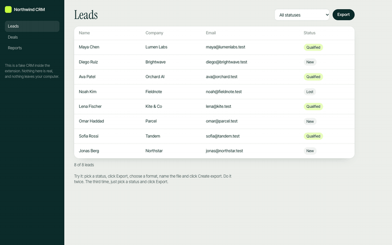

# Hi, this is Tabmate.

It watches how you work in Chrome, notices when you do the same thing twice, and then does it for you.

**You work once. Tabmate does it forever.**



This is a test. A real one. It's open source, it's free, and it probably breaks on some sites. Try it on your boring stuff and [tell us what breaks](../../issues). That's the whole ask.

## Install (3 steps, about a minute)

The Chrome Web Store version is on the way. Until then:

1. **Get the code.** Download [tabmate-extension.zip](https://trytabmate.com/download/tabmate-extension.zip) and unzip it, or clone this repo.
2. **Open `chrome://extensions`** and turn on **Developer mode** (top right).
3. Click **Load unpacked** and pick the `tabmate-extension` folder (or the `extension/` folder if you cloned the repo).

A welcome page opens with a fake CRM to try it on. Do the export task twice, then start it a third time and watch.

## How it works

No AI model, no server. Just your browser.

- **It records.** On each page it notes what you click, type, pick and submit, with a sturdy way to find each element again (`data-testid`, `id`, `aria-label`, `name`, button text, and a CSS path as the last resort).
- **It spots repeats.** When the same 3+ steps happen twice on the same site, it saves them as a workflow and names it, like "Export leads on crm.example.com". The little pill at the bottom of the page says **Learned**.
- **It takes over.** Next time you start that task (the first 1 or 2 steps), Tabmate finishes it. A lime ghost cursor moves to each thing before it clicks or types, so you can see what it's doing. It works across page loads.
- **You stay in charge.** Press **Esc** or click anywhere and it stops right away. Every workflow can be turned off, run, or deleted from the toolbar popup. There's an activity log of everything it did.

## The safety rules

- It **never records** passwords, card numbers (`autocomplete="cc-*"`), CVV, or SSN fields, or anything labelled like them. Those steps are saved as "you fill this", with no value.
- It **never types** into those fields. It stops and shows **Needs you** until you fill them.
- It **won't click** buttons that say pay, buy, purchase, delete, transfer or confirm payment. It stops and lets you click.
- Pause it everywhere, or turn it off for one site, from the popup.


## Privacy

Everything stays on your computer, in `chrome.storage.local`. Tabmate makes **zero network calls**: no analytics, no server, no remote code. The tests check this on every run. Fonts are bundled.

Why it asks for "read and change all your data on all websites" (`<all_urls>`): it has to run on whatever sites you work on to learn and repeat your tasks. You can't learn a workflow on a site you can't see. Other permissions: `storage` (save workflows locally), `tabs` and `activeTab` (know which tab to run in, and open the welcome page), `scripting` (start Tabmate in a tab that was open before you installed it).

## Bonus: every website, an MCP server (beta)

Open the extension's options page. Each learned workflow is listed as a named tool with a JSON schema you can copy or download. It's an export only. No native host, no server.

## Run the tests

```bash
npm install
npm test            # or: npm run test:headed
```

The tests load the extension into Chromium and use real mouse and keyboard input to: learn a workflow from two runs, let Tabmate finish the third run, run it from the pill and the popup (across page loads), stop it with Esc and with a click, check that card/CVV/password values never hit storage, check the "Needs you" pauses, test pause and per-site blocking, and check there are no network calls or console errors. Screenshots land in `screenshots/`.

They use Chrome for Testing if Playwright installed it (`npx playwright install chromium`). Set `TABMATE_CHROME=/path/to/chrome` to use another build, and `TABMATE_EXT=/path/to/unzipped/folder` to test a built zip. Regular Google Chrome no longer accepts `--load-extension`.

`npm run build` makes the zips in `dist/`.

## What's in here

```
extension/          the extension (this is what you load)
  content.js        the pill, the recorder and the runner
  background.js     pattern detection, run state, storage
  popup.*           toolbar popup
  welcome.*         first-run page
  options.*         MCP export (beta)
  sandbox/          fake CRM to try it on
tests/              end-to-end tests + 2 small test sites
scripts/            build, icons, store screenshots, demo gif
store/              Chrome Web Store listing and images
```

## Roadmap

- Chrome Web Store release
- Edit a learned workflow (rename, change a typed value, drop a step)
- Inputs: ask for a value when a step changes every time
- Better matching on sites that rebuild their HTML a lot
- Workflows that span more than one site
- A real local MCP bridge, opt-in

## Contributing

Yes please. Read [CONTRIBUTING.md](CONTRIBUTING.md). Bugs with a site name and the steps you took are gold.

Updates and waitlist: [trytabmate.com](https://trytabmate.com).

MIT license. Go build something.
