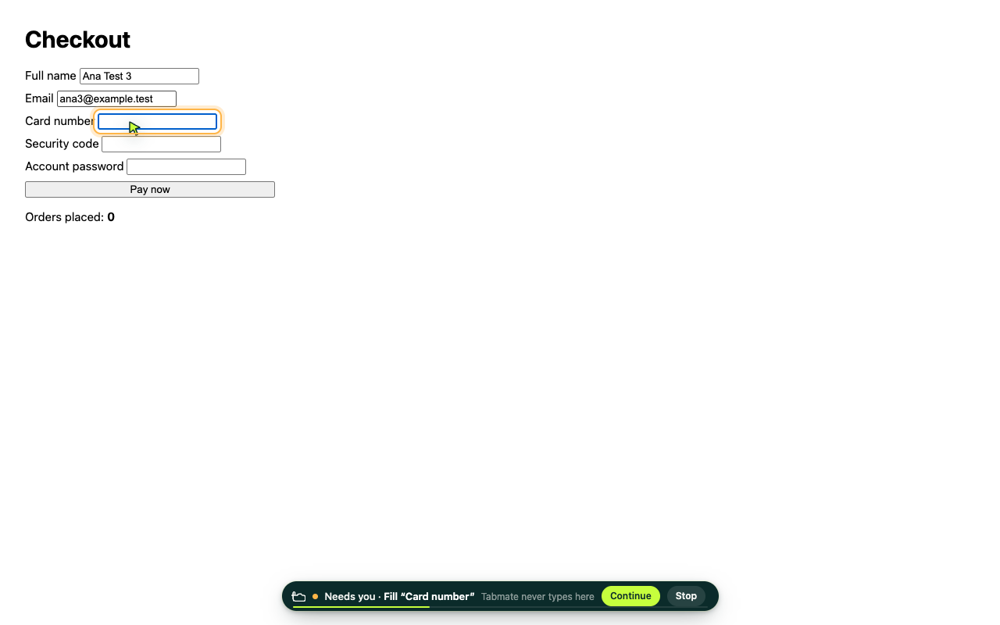

# Hi, this is Tabmate.

It watches you do a task once or twice, then does it for you on its own.
No prompts, no approvals, no setup.

**You work once. Tabmate does it forever.**


Free. Open source (MIT). Everything stays on your computer.

This is an early test. It will break on some sites. Try it on your boring stuff and [tell us what breaks](../../issues).

## Install (about 2 minutes)

The easiest way is the step-by-step guide at **[trytabmate.com/download](https://trytabmate.com/download)**. It shows every click. Coming soon to the Chrome Web Store (1-click install).

1. **Get it.** Download [tabmate.zip](https://trytabmate.com/download/tabmate.zip). Unzip it: double-click it on a Mac, or right-click and pick **Extract All** on Windows. You get a folder called `tabmate`. Or clone this repo.
2. **Open `chrome://extensions`** (copy it and paste it in the address bar) and turn on **Developer mode** (top right).
3. Click **Load unpacked** and pick the `tabmate` folder (or `extension/` if you cloned).

A welcome page opens. It walks you through a short practice: you do a small task twice, Tabmate learns it, then does it by itself while you watch.

## What it does

- **Learns by watching.** Do the same 3+ steps twice and Tabmate saves them. The pill at the bottom says **Learned**.
- **Works across tabs and sites.** Copy a row from one site, paste it into a form on another, click Add. Tabmate remembers which tab each step was in. When it replays, it focuses the right tab, or opens it if you closed it.
- **Fills in the right values.** If what you typed changed between your two runs, Tabmate finds where it came from: text you copied, or a cell in the row you were on. Next time it reads the fresh value from the page instead of retyping an old one.
- **Works down a list.** If you handled a list one row at a time, Tabmate does every new row for you, and remembers which rows are done.
- **Takes over on its own.** Start the task (the first 1 or 2 steps) and Tabmate finishes it. A lime cursor shows each click before it happens.
- **Calm about it.** A small glass pill at the bottom says what it is doing. "Learned" comes with an **Undo**. When it finishes, it says how much time it saved and gets out of the way. The toolbar menu shows what it did for you today.
- **Copes with messy pages.** It finds things by role, label, placeholder, nearby text and position, not just ids. It waits for pages that render late, and works with React and Vue forms, custom dropdowns, rich text boxes, shadow DOM, same-origin iframes, and keyboard shortcuts.

## You stay in charge

- Press **Esc**, or click anywhere, and it stops at once.
- It **never records** passwords, card numbers, CVV or SSN fields. It **never types** into them. It stops and says **Needs you**.
- It **won't click** pay, buy, purchase, delete, transfer or confirm payment. It stops and lets you click.
- Turn any workflow off, run it, or delete it from the toolbar popup. Pause everywhere, or block one site.
- There is an activity log of everything it did.



## Connect to Claude

Every website, an MCP server. Each workflow Tabmate learned can be a tool for Claude Desktop and Claude Code.

1. Click the Tabmate icon. Under **Claude**, click **Copy**.
2. Paste it in Terminal and press Enter. It looks like this:

   ```bash
   npx -y github:LuisSantiagoLopez/tabmate-mcp install --token <your token>
   ```

3. Restart Claude Desktop. The popup says **Connected to Claude**.

Now ask Claude things like "add the new leads to the CRM". Claude sees:

- `list_workflows`: what Tabmate learned
- `run_workflow`: run one by name
- one tool per workflow, with its inputs

Claude runs them in your Chrome, with the same safety rules. Passwords, card fields and pay buttons still wait for you.

What `install` does: it adds a `tabmate` entry to Claude Desktop's and Claude Code's MCP config. It backs up each file first and never touches your other servers. `npx -y github:LuisSantiagoLopez/tabmate-mcp uninstall` removes it.

How it stays private:

- The link is your own computer only (`127.0.0.1`). Nothing on the internet can reach it.
- The extension and the server prove they share a random pairing token. The token itself is never sent.
- The server refuses web pages and anything that is not the extension.
- It is off until you click Copy (or turn on "Claude can run my workflows").

The server lives in [`mcp/`](mcp/) and is published as its own repo, [tabmate-mcp](https://github.com/LuisSantiagoLopez/tabmate-mcp). `npx` installs it straight from GitHub (it is not on npm). You need Node.js 18 or newer. From a clone you can also run `node mcp/bin/tabmate-mcp.js install --token <token>`.

## Privacy

Everything stays in your browser (`chrome.storage.local`). No account, no server, no analytics, no remote code. Fonts are bundled. The tests check for network calls on every run.

The one exception is the Claude link above. It only talks to `127.0.0.1`, and only after you turn it on.

Permissions, and why:

- `<all_urls>`: it has to run on the sites you work on to learn and repeat your tasks.
- `storage`: save workflows locally.
- `tabs`, `activeTab`: find, focus and open the right tab for each step.
- `scripting`: start Tabmate in a tab that was open before you installed it.
- `alarms`: look for the Claude link every 30 seconds, only while it is turned on.

## Run the tests

```bash
npm install
npm test              # everything local: unit, core, cross-site + Claude, React SPA, a work day, onboarding
npm run test:real     # real public sites (needs internet, 3 tries each)
sh scripts/live-check.sh  # download from trytabmate.com, unzip, and run all of the above on that folder
npm run test:headed   # watch it happen
```

The tests load the extension into Chromium and use real mouse, keyboard and clipboard input. They cover:

- learning from two runs and taking over on the third, across page loads
- a two-site workflow on two local servers (copy from site A, paste into site B), with a list of new rows done in one go
- an MCP client calling `run_workflow` through `tabmate-mcp`, including opening a closed tab
- a React app with random ids, late rendering, a custom dropdown, an iframe, shadow DOM, rich text and Ctrl+Enter
- Esc and click to stop, card/CVV/password never stored, "Needs you" pauses, pause and per-site block
- a simulated work day: three sites, two repeated tasks mixed with normal browsing, an Undo, a browser restart at lunch, then Tabmate finishing both tasks by itself and the "Today" summary in the popup
- a first-time user going through the onboarding exactly as a new person would (welcome, practice twice, "I learned it!", Tabmate does it alone, pin, Claude, done)
- the guided installer at trytabmate.com/download on desktop (1440 wide) and a phone (390 wide)
- no network calls and no console errors
- unit tests for the learning logic, the config installer and the link security

They use Chrome for Testing if Playwright installed it (`npx playwright install chromium`). `TABMATE_CHROME=/path/to/chrome` picks another build. `TABMATE_EXT=/path/to/unzipped/folder` tests a built zip. Regular Google Chrome no longer accepts `--load-extension`.

`npm run build` makes the zips in `dist/`.

## What works on real sites

`npm run test:real` does each task twice by hand, then starts it a third time and lets Tabmate finish. Last run, 18 Nov 2026: **4 of 4 passed.**

| Site | Task | Result |
|---|---|---|
| the-internet.herokuapp.com | open Checkboxes, tick one, untick one | pass |
| the-internet.herokuapp.com | log in: Tabmate types the username, waits for you at the password | pass |
| demoqa.com/text-box | fill a 4-field form and submit | pass |
| todomvc.com (React) | add a todo with Enter, tick the newest one | pass |

These are live sites. When they are slow, page loads time out and a case fails before Tabmate starts (it happened in earlier runs the same day).

## Known limits

- Cross-origin iframes and closed shadow roots are out of reach.
- Lists: rows are matched by position and text. If a site reorders rows between runs, it may pick the wrong one.
- A value it cannot trace to the page is replayed as the last value you typed (Claude can pass a new one).
- One workflow runs at a time.
- Sites that block untrusted events (some canvas apps, some games) won't respond.

## What's in here

```
extension/          the extension (this is what you load)
  content.js        the pill, the recorder and the step runner
  background.js     timeline, learning, the cross-tab runner, storage
  bridge.js         the optional Claude link (127.0.0.1 only)
  lib/learn.js      learning logic: patterns, variables, lists (pure, unit tested)
  lib/finder.js     finding elements again (shadow DOM, iframes, scoring)
  popup.*           toolbar popup
  options.*         tools for Claude
  sandbox/          fake CRM to try it on
mcp/                tabmate-mcp: the MCP server and installer
tests/              end-to-end suites, unit tests, and small test sites
scripts/            build, icons, store screenshots, demo gif
store/              Chrome Web Store listing and images
```

## Contributing

Yes please. Read [CONTRIBUTING.md](CONTRIBUTING.md). Bugs with a site name and the steps you took are gold.

Updates: [trytabmate.com](https://trytabmate.com).

MIT license. Go build something.
